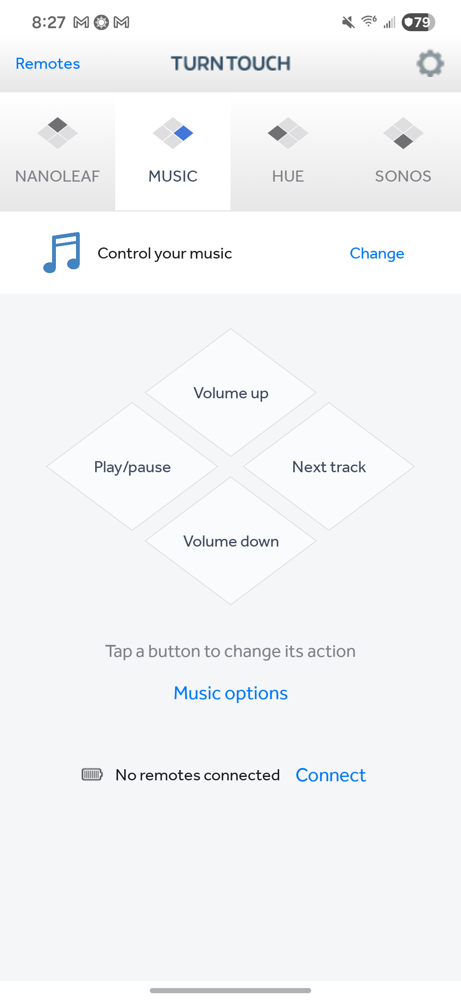
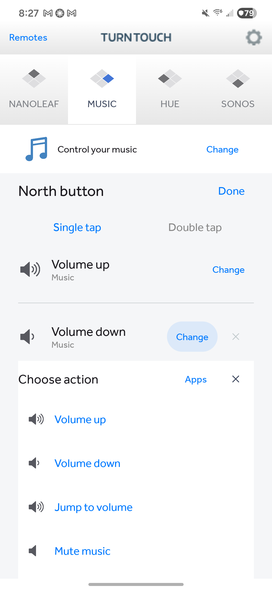
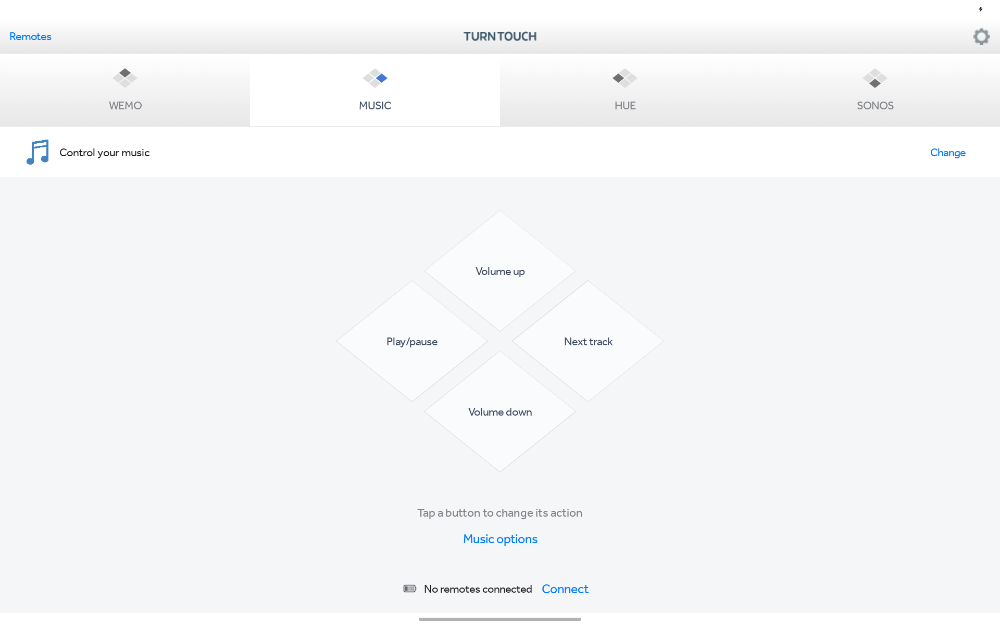
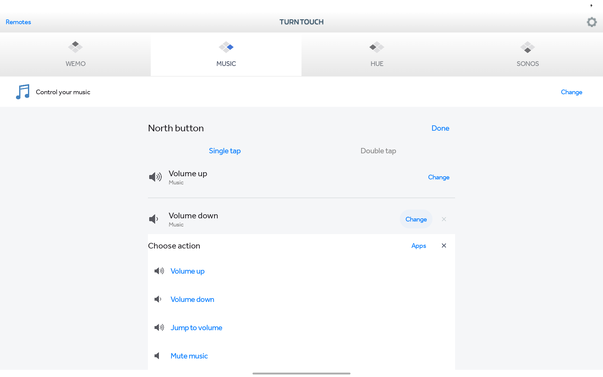

# Turn Touch Android App
> A native Kotlin app for configuring and using the Turn Touch smart wooden remote.

<a href="https://turntouch.com"><br />Available at turntouch.com</a>

[![License][license-image]][license-url]
[](https://developer.android.com)
[](https://github.com/samuelclay/turntouch-android/actions/workflows/android.yml)
[](https://github.com/samuelclay/turntouch-android/pulls)

## Screenshots of Turn Touch on Android phones

App | Choose an action
:---:|:---:
 | 

## Screenshots of Turn Touch on Android tablets

App | Choose an action
:---:|:---:
 | 

## Features

[Turn Touch](https://turntouch.com) is a smart home remote control carved out of beautiful wood. This Android companion brings the iOS app's four-button interface, original artwork, and Effra typography to phones and tablets using Kotlin and Jetpack Compose.

- **Four buttons, many actions:** Configure single taps, double taps, holds, and batches of actions. Switch between 12-button and 16-button layouts.
- **Bluetooth remotes:** Discover Turn Touch remotes, confirm all four buttons, rename them, and read battery information. A foreground service supports background listening and reconnection.
- **Lights and scenes:** Pair Hue and Nanoleaf on your local network with automatic checks for the physical pairing button. Choose rooms, scenes, and effects directly below each action.
- **Native Android controls:** Control device volume and the active media session, capture photos and video, and open web content.
- **Original design:** Reuses Turn Touch's icons, fonts, and diamond interface, with full-face touch feedback and inline configuration.

This is an **early development build**, not a finished port or a Play Store release. Hue and Nanoleaf pairing and their live selectors have been checked on physical Samsung devices; several other integrations and platform features remain incomplete or unverified. See [implementation and testing status](docs/STATUS.md) before relying on an integration.

## Requirements

- Android 8.0 (API 26) or later; phones and tablets supported.
- Bluetooth Low Energy for a Turn Touch remote.
- The same Wi-Fi network as your local smart-home devices.
- Android Studio, JDK 17 or 21, and Android SDK 36 to build.

## Installation

### Build the app

Open this repository in Android Studio and let Gradle sync, or run:

```sh
./gradlew :app:assembleDebug
```

If your shell uses a different JDK, set `JAVA_HOME` to a compatible JDK. On macOS, Android Studio's bundled runtime can be used:

```sh
export JAVA_HOME='/Applications/Android Studio.app/Contents/jbr/Contents/Home'
./gradlew :app:assembleDebug
```

### Run on a device

Enable USB debugging, connect your Android device, and install:

```sh
adb -s DEVICE_SERIAL install -r app/build/outputs/apk/debug/app-debug.apk
adb -s DEVICE_SERIAL shell am start -n com.turntouch.android/.MainActivity
```

Grant Nearby devices permission when prompted. Wake your Turn Touch, open **Remotes**, and follow the four-button pairing instructions. A remote already connected to another computer or phone may need to disconnect there first.

For Hue or Nanoleaf, open the app's connection options, select the discovered bridge or panels, and follow the physical-button instructions. Turn Touch checks automatically while that screen is active. Connection credentials are stored using Android Keystore-backed encryption.

### Tests

```sh
./gradlew :app:testDebugUnitTest :app:assembleDebugAndroidTest
```

UI and hardware tests run on an attached device:

```sh
./gradlew :app:connectedDebugAndroidTest
```

Some instrumentation tests require connected Hue/Nanoleaf devices or exercise Bluetooth. Read [testing notes](docs/STATUS.md#testing) before running the full device suite. Unit tests require no hardware.

## Contribute

Contributions to the **Turn Touch Android app** are welcome.

1. Review the corresponding action in the [iOS](https://github.com/samuelclay/turntouch-ios) or [Mac](https://github.com/samuelclay/turntouch-mac) app.
2. Add its metadata to [the action catalog](app/src/main/assets/catalog.json), implement behavior in [the Android source](app/src/main/java/com/turntouch/android), and add any needed inline options.
3. Reuse the existing artwork and interaction patterns. Prefer native Android behavior for platform-specific actions.
4. Verify the UI on a phone and tablet, and test the actual device protocol when hardware is available.
5. Submit a pull request describing the behavior and what was tested.

The optional [import script](scripts/import_ios.py) refreshes artwork and catalog metadata from sibling `../ios` and `../mac` checkouts. Building the Android app does not require those repositories.

## Turn Touch open source repositories and documentation

- [Turn Touch Android app](https://github.com/samuelclay/turntouch-android)
- [Turn Touch iOS app](https://github.com/samuelclay/turntouch-ios)
- [Turn Touch Mac app](https://github.com/samuelclay/turntouch-mac)
- [Turn Touch remote firmware and board layout](https://github.com/samuelclay/turntouch-remote)
- [Turn Touch enclosure, CAD, and CAM](https://github.com/samuelclay/turntouch-enclosure)
- [Everything you need to build your own Turn Touch smart remote](https://ofbrooklyn.com/2019/01/3/building-turntouch/)

## Author

Samuel Clay – [@samuelclay](https://twitter.com/samuelclay) – [samuelclay.com](https://samuelclay.com)

Distributed under the MIT license. See [LICENSE](LICENSE) for more information.

[license-image]: https://img.shields.io/badge/License-MIT-blue.svg
[license-url]: LICENSE
